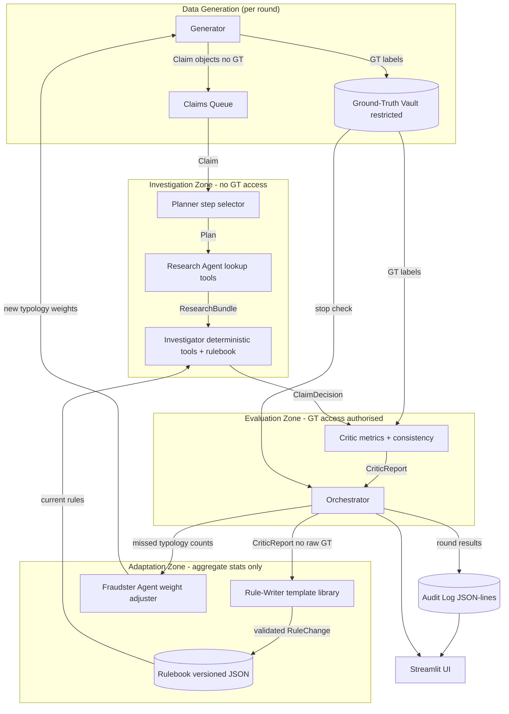

# Architecture — Shard: Adversarial Multi-Agent Insurance Claims Auditor

> **Status**: PLANNED — no components are operational yet. This document describes the target architecture for implementation.

---

## 1. Component Responsibilities

### 1.1 Synthetic Data Generator (`shard/data/generator.py`)
- Produces seeded, reproducible batches of motor insurance claims.
- Each claim includes: claim ID, date, vehicle details, incident description, claimed amount, claimant history stub, repair provider ID.
- Ground-truth fraud label and fraud typology are generated and stored **only** in the Ground-Truth Vault. They are never included in the claim object passed to agents.
- Configurable: `n_claims`, `seed`, `fraud_fraction`, `typology_weights`.

### 1.2 Ground-Truth Vault (`shard/data/vault.py`)
- Stores the mapping `{claim_id -> (is_fraud: bool, typology: str)}`.
- Exposes a single read method: `get_labels(claim_ids: list[str]) -> dict[str, bool]`.
- Access control: only `Critic` and `Orchestrator` (for stopping condition) may import this module.
- **No other module may import `vault.py`.** This is enforced by a lint check in the test suite.

### 1.3 Fraudster Agent (`shard/agents/fraudster.py`)
- Receives the previous round's Critic report (typologies that evaded detection).
- Adjusts `typology_weights` to increase representation of evasive patterns.
- Does **not** access ground-truth labels directly; it reads only the Critic's aggregate typology-miss report.
- Produces a new `GeneratorConfig` for the next round.

### 1.4 Planner Agent (`shard/agents/planner.py`)
- Receives a single `Claim` object (no GT label).
- Selects an ordered list of investigation steps from a fixed catalogue.
- Investigation step catalogue: `VERIFY_VEHICLE`, `CHECK_CLAIMANT_HISTORY`, `BENCHMARK_REPAIR_COST`, `CHECK_PROVIDER_LINKS`, `CROSS_REFERENCE_INCIDENT`, `FLAG_NETWORK_CLUSTER`.
- Returns a `Plan` (ordered list of `InvestigationStep` names).
- Selection logic: rule-based on claim features (claimed amount, incident type, provider ID patterns).

### 1.5 Research Agent (`shard/agents/researcher.py`)
- Receives a `Claim` and a `Plan`.
- Executes non-scoring information gathering: looks up synthetic policy records, claimant history and provider registry.
- Returns a `ResearchBundle` (typed dict with policy details, claimant history summary, provider risk flag).
- Does **not** score or decide. Does **not** access GT labels.

### 1.6 Investigator Agent (`shard/agents/investigator.py`)
- Receives a `Claim`, `Plan`, `ResearchBundle` and the current `Rulebook`.
- Executes each step in the Plan as a deterministic tool call.
- Tools available:
  - `verify_vehicle(claim)` -> `VehicleCheckResult`
  - `check_claimant_history(research_bundle)` -> `HistoryCheckResult`
  - `benchmark_repair_cost(claim, research_bundle)` -> `CostCheckResult`
  - `check_provider_links(research_bundle)` -> `ProviderCheckResult`
  - `cross_reference_incident(claim, research_bundle)` -> `IncidentCheckResult`
  - `flag_network_cluster(claim, research_bundle)` -> `NetworkCheckResult`
- Applies `Rulebook` thresholds to compute a `RiskScore` (0.0 to 100.0).
- Returns a `ClaimDecision` with: `claim_id`, `risk_score`, `disposition` (APPROVE/REFER/SUSPECTED_FRAUD), `findings` (list of evidence items), `tool_trace` (ordered list of tool calls and results).
- **Does not access GT labels.**

### 1.7 Critic Agent (`shard/agents/critic.py`)
- **Only agent besides the Orchestrator that accesses GT labels.**
- Receives the full list of `ClaimDecision` objects for a round and fetches GT labels from the Vault.
- Computes: precision, recall, F1 on the `SUSPECTED_FRAUD` disposition vs. GT `is_fraud`.
- Identifies missed frauds (GT=fraud, disposition!=SUSPECTED_FRAUD) and their typologies.
- Checks internal consistency: disposition must match risk score band; every SUSPECTED_FRAUD must have at least 1 finding.
- Produces a `CriticReport`: metrics, missed typologies (aggregate counts only, no individual GT labels passed out), consistency violations.

### 1.8 Rule-Writer Agent (`shard/agents/rule_writer.py`)
- Receives a `CriticReport` and the current `Rulebook`.
- Proposes bounded rule changes from a **fixed template library** (`shard/rules/templates.py`).
- Templates are parameterised Python functions (no LLM code generation, no `eval`/`exec`).
- Validates each proposed update against the genuine-claims validation set (FP budget check).
- Accepts update only if: `new_fp_rate <= current_fp_rate + FP_BUDGET_DELTA`.
- Returns an `UpdateProposal`: list of `RuleChange` objects or empty list if none pass.

### 1.9 Orchestrator (`shard/orchestrator.py`)
- Controls the round lifecycle.
- Accesses GT labels only to evaluate the stopping condition.
- Stopping conditions (configurable): max rounds reached, or recall >= target.
- On each round:
  1. Generate claims via Data Generator.
  2. For each claim: run Planner -> Research -> Investigator.
  3. Run Critic on all decisions.
  4. If stopping condition met: return final results.
  5. Run Rule-Writer; if accepted, update Rulebook and record version.
  6. Run Fraudster to generate next-round config.
  7. Repeat.
- Writes all events to the Audit Log.

### 1.10 Rulebook (`shard/rules/rulebook.py`)
- Versioned JSON file (`data/rulebook.json`).
- Stores: rule ID, template ID, parameters, active flag, version history.

### 1.11 Audit Logger (`shard/logging/audit.py`)
- Writes structured JSON-lines to `data/audit_YYYYMMDD_HHMMSS.jsonl` (or configured log path).
- Event types: `EXPERIMENT_INIT`, `ROUND_START`, `CLAIM_DECISION` (100% decision coverage), `CRITIC_REPORT`, `RULE_PROPOSAL`, `RULE_VALIDATION`, `FRAUDSTER_ADAPTATION`, `ROUND_END`, `EXPERIMENT_END`.
- Every event includes: `sequence` (strictly monotonic), `event_type`, `run_id`, `round_number`, `payload`, `timestamp`.
- Enforces strict sanitization to strip prohibited hidden labels (`is_fraud`, `vault_record`).
- Exposes `to_canonical_dict()` excluding timestamps for bit-identical reproducibility diffs.

### 1.12 Streamlit Application (`app/streamlit_app.py`)
- Launches the Orchestrator in-process.
- Tabs: **Run**, **Claims**, **Traces**, **Metrics**, **Rulebook**, **Audit Log**.
- **All displayed values come from the executed pipeline session state or the audit log.** No hardcoded numbers.

---

## 2. Trust Boundaries

```
+-------------------------------------------------------------------+
|  INVESTIGATION ZONE (no GT access)                                |
|  Planner  -->  Research  -->  Investigator                        |
+-------------------------------------------------------------------+
                                     |
                                     v  ClaimDecision list
+-------------------------------------------------------------------+
|  EVALUATION ZONE (GT access authorised)                           |
|  Critic <-- Vault  |  Orchestrator <-- Vault (stop condition)    |
+-------------------------------------------------------------------+
                                     |
                                     v  CriticReport (no raw GT)
+-------------------------------------------------------------------+
|  ADAPTATION ZONE (no GT access, only aggregate miss counts)       |
|  Rule-Writer  |  Fraudster                                        |
+-------------------------------------------------------------------+
```

**Enforcement mechanism**: a pytest-based lint test will grep for `vault` imports in every module outside the authorised set and fail if any are found.

---

## 3. Data Contracts (Planned Types)

```python
# shard/core/models.py  (planned)

@dataclass
class Claim:
    claim_id: str
    date: str
    vehicle_reg: str
    vehicle_make: str
    vehicle_year: int
    incident_type: str      # COLLISION | THEFT | WEATHER | FIRE
    claimed_amount: float
    claimant_id: str
    provider_id: str
    incident_description: str
    # GT label deliberately excluded

@dataclass
class Finding:
    check_name: str
    result: str
    risk_contribution: float
    detail: str

@dataclass
class ClaimDecision:
    claim_id: str
    risk_score: float           # 0.0-100.0
    disposition: Disposition    # APPROVE | REFER | SUSPECTED_FRAUD
    findings: list[Finding]     # must be non-empty
    tool_trace: list[dict]
    round_number: int

@dataclass
class CriticReport:
    round_number: int
    precision: float
    recall: float
    f1: float
    missed_typology_counts: dict[str, int]  # {typology: count}, no GT IDs
    consistency_violations: list[str]
    total_claims: int
    tp: int
    fp: int
    fn: int
    tn: int

@dataclass
class RuleChange:
    rule_id: str
    template_id: str
    old_params: dict
    new_params: dict
    rationale: str
```

---

## 4. Mermaid Architecture Diagram



---

## 5. Round Lifecycle

```
Round N:
  1. Generator produces N_CLAIMS with current typology_weights.
  2. For each claim (parallelisable):
     a. Planner selects investigation steps.
     b. Research Agent gathers evidence.
     c. Investigator runs tools, applies rulebook, produces ClaimDecision.
  3. Critic evaluates all ClaimDecisions against GT vault -> CriticReport.
  4. Orchestrator checks stopping condition:
     - If recall >= TARGET_RECALL or round >= MAX_ROUNDS -> stop.
  5. Rule-Writer proposes updates; validated against genuine-claims set.
     - If FP rate would exceed FP_BUDGET: update rejected (logged).
     - If accepted: Rulebook version incremented.
  6. Fraudster receives missed typology counts; adjusts weights for round N+1.
  7. Audit log flushed.
```

## 6. Stopping Conditions

- `MAX_ROUNDS` (default: 5, configurable via UI).
- `TARGET_RECALL` (default: 0.80, configurable via UI).
- First condition met triggers stop.

## 7. False-Positive Budget

- `FP_BUDGET_DELTA` (default: 0.05): maximum allowed increase in false-positive rate from a single rule update.
- Validation set: the genuine claims generated in round 1 (frozen, not updated).
- Rule-Writer re-scores all genuine validation claims with the proposed new rule; if FP rate rises by more than the budget, the update is rejected.

## 8. Reproducibility Strategy

- All random operations use `random.Random(seed)` and `numpy.random.default_rng(seed)` instances, never the global state.
- Seed is stored in session state and in every audit log ROUND_SUMMARY event.
- Running `orchestrator.run(seed=42, n_rounds=3, n_claims=30)` twice must produce bit-identical audit logs.

## 9. Rulebook Version History

- Each `RuleChange` records: `version`, `round`, `timestamp`, `rule_id`, `old_params`, `new_params`, `validation_fp_rate`, `rationale`.
- Full history is retained in `data/rulebook.json` under a `history` key.
- The Streamlit Rulebook tab shows a diff view between consecutive versions.
